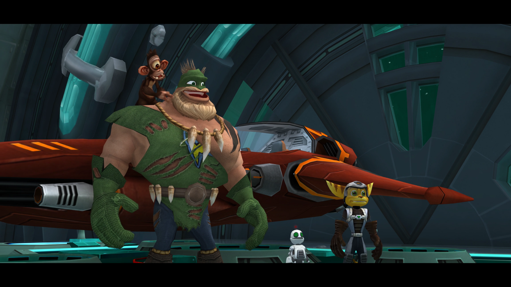
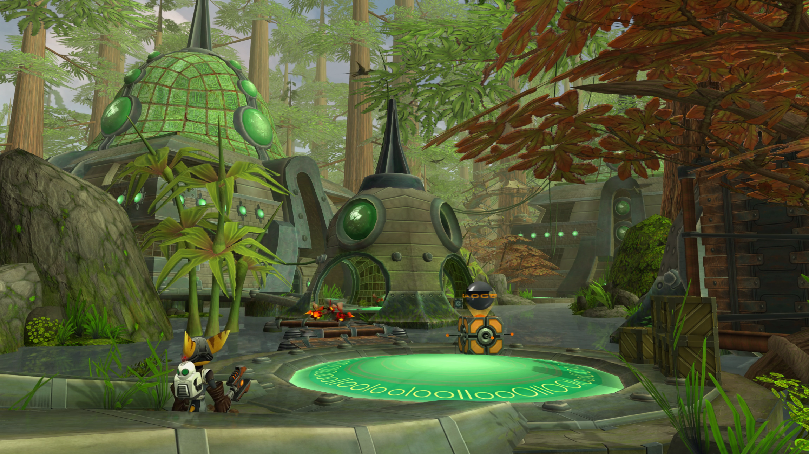
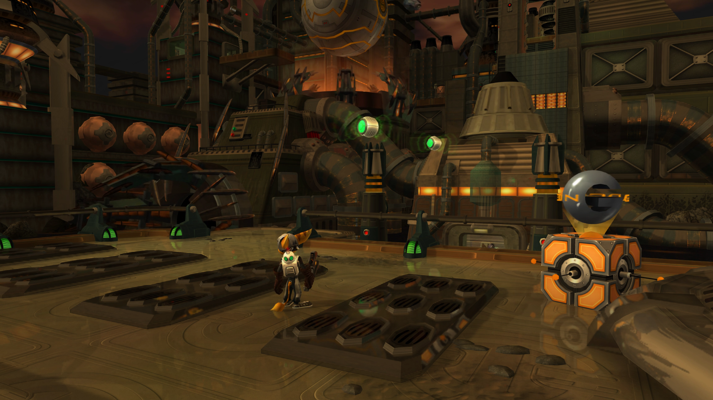
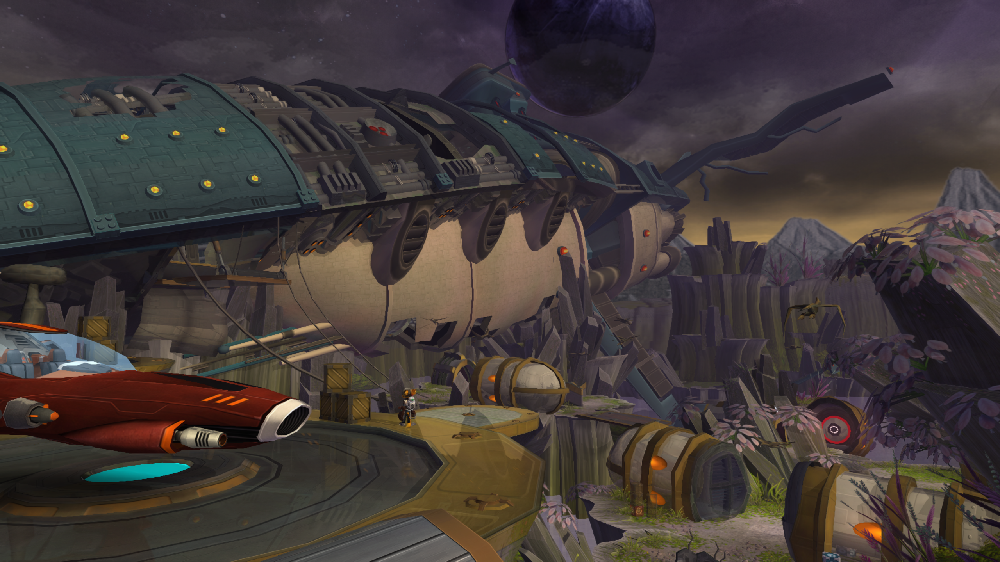
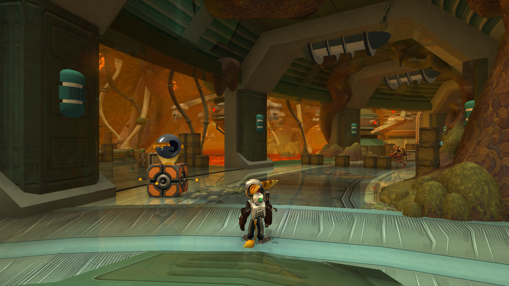
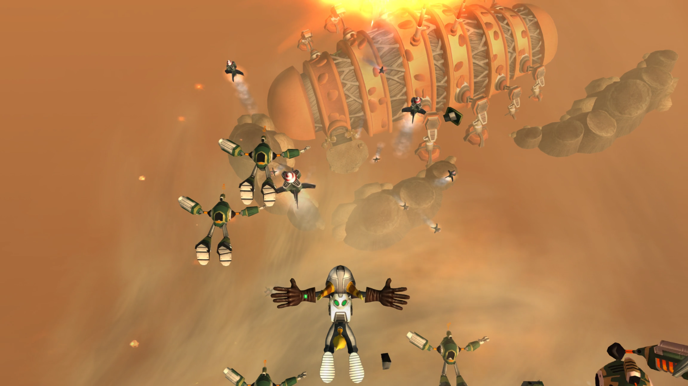

# Ratchet & Clank: Up Your Arsenal PC remaster

[](https://recompstore.com/dev/sneid1)
[](https://recomplauncher.com/game/ratchet3-pc-remaster)

A native PC port of Up Your Arsenal (PS2, 2004), built from the game's own code: the disc's machine code is translated ahead of time and runs on this project's own runtime and renderer, with this project's own code where the PS2 had hardware. You bring your own copy of the game, the USA disc (SCUS-97353), and the disc stays in play the whole time, streaming what it streamed on the PlayStation 2.

## What it looks like

<p float="left">
  
  
</p>
<p float="left">
  
  
</p>
<p float="left">
  
  
</p>

## The remaster

- Updated textures, on by default: 4,990 surfaces across 1,134 new materials, each with surface grain, normal-mapped relief and gloss, lit per pixel at the material's own look; 6,623 of them carry generated height, so brick, bark and sand catch the light. Turn it off and the game draws its own picture, unchanged.
- Ray tracing, which needs DLSS and an RTX GPU: the level's sun found by ray queries through the terrain, the ties, the shrubs and the characters, each leaf and blade cut out by its own texture; light bounced off sunlit walls, water and glow into the shade, with the ambient occlusion traced as well; water, swamp, slime and the game's chrome reflecting the whole level, off screen too.
- NVIDIA's DLSS: Super Resolution (DLAA, Quality, Balanced, Performance) draws the world smaller and rebuilds it sharp, and Frame Generation (2X to 4X, through Streamline) makes frames between the drawn ones, up to the screen's rate. The HUD and menus are drawn after DLSS at full size, so they stay sharp.
- The rest of the graphics page: per-pixel lighting, ambient occlusion, water reflections, sun light shafts, texture filtering to 16x, widescreen at the screen's own shape, and a field-of-view option whose culls and targeting follow it.
- A PC game throughout: the game's own front end and pause menus with a PC settings page inside them, keyboard and mouse (menus by pointer and click, aiming with the mouse), Xbox, DualSense and DualShock 4 with their own button prompts, rebindable keys, saves as plain files, and 59.94 fields of game time a second with a picture at every refresh above 60 Hz.

## Requirements

- Windows 10 or 11, 64-bit.
- A Direct3D 12 / Vulkan GPU. DLSS and the ray-traced options need an NVIDIA RTX card; frame generation needs an RTX 40 or 50.
- Your own disc image of the USA release (SCUS-97353).

## Install

With [RecompLauncher](https://github.com/elripalda/RecompLauncher) (recommended): install the game, drop your `.iso` on the setup screen when asked, press Play. The release's updated-textures volumes are optional; download them from the release page and extract them into the game's folder (a README inside each volume says where).

By hand: download `ratchet3-pc-remaster-<version>-Windows-x64.zip` from [Releases](https://github.com/sneid1/ratchet3-pc-remaster/releases), extract it anywhere, and run `uya.exe`:

```
uya.exe play C:\path\to\SCUS_973.53.iso
```

Without the textures volumes the game plays with its own textures; with them, it finds them beside the program. Saves, settings and logs are written next to the program by default; `--profile DIR` moves them.

## Building from source

- A Rust toolchain (`x86_64-pc-windows-msvc`) and Visual Studio's Build Tools.
- Four folders named in the environment of the build, for NVIDIA's SDKs: `DLSS_SDK` (NVIDIA's DLSS SDK), `VULKAN_SDK` (a folder whose `Include` holds `vulkan\`), `LIBCLANG_PATH` (a folder with `libclang.dll`) and `STREAMLINE_SDK` (NVIDIA's Streamline SDK).
- `powershell -ExecutionPolicy Bypass -File scripts\build.ps1` builds the game (`port\`): `uya.exe` with its own crates `uyafmt`, `uyart`, `uycpu`. `scripts\package-release.ps1` assembles a release folder, zip and textures volumes.
- The level libraries (`tr_l01.dll` … `tr_l36.dll`) are the game's own code, translated from the disc by this project's translator; they are built from your own copy of the game (`scripts\uyatr.ps1`, then `scripts\build-levels.ps1`) and are not in the repository. The release ships them built.

## Repository layout

| | |
| --- | --- |
| `port/uya` | the game: its runtime, renderer, sound engine, settings and window (`uya play`, `uya native`) |
| `port/uyart`, `port/uycpu` | the runtime the translated code runs on: kernel, hardware, IOP servers, VU0 as native code |
| `port/uyafmt` | the game's own format decoders, written for this game's data |
| `port/uyatr` | the translator: the disc's EE code to Rust, ahead of time |
| `port/uyaref` | the emulated reference (built on rac-rs), the instrument the port is checked against; never what players run |
| `scripts/` | the build, the recompiler and translator drivers, the texture and model pipelines |
| `patches/rac-rs/` | the patches behind the emulated reference's base |
| `textures/` | the texture packs' index files |

`disc/`, `generated/`, `translated/` and the build outputs stay local (`.gitignore`); nothing from the game is in this repository.

## Legal

This is a fan project for preservation and education. It is not affiliated with, endorsed by or sponsored by Sony Interactive Entertainment or Insomniac Games. "Ratchet & Clank" is a trademark of Sony Interactive Entertainment LLC. All game content belongs to its owners.

NVIDIA, RTX and DLSS are trademarks and/or registered trademarks of NVIDIA Corporation in the U.S. and other countries. AMD, Radeon and FidelityFX are trademarks of Advanced Micro Devices, Inc. Windows and DirectX are trademarks of the Microsoft group of companies. This project is not affiliated with, endorsed by or sponsored by NVIDIA, AMD or Microsoft.

This repository holds this project's source code and tools. The game's assets (its levels, textures, sounds and movies) and the disc image are not distributed here, and nothing extracted from them is. The releases do carry the game's own code, recompiled from the original disc by this project's translator, and the remaster's updated textures, updated versions of the game's own art: both are of no use without the game, which is why you need your own copy of Ratchet & Clank: Up Your Arsenal (NOTICE.md names each part and whose it is).

## License

GPL-3.0-or-later, see [LICENSE](LICENSE). Credits for third-party work are in [NOTICE.md](NOTICE.md). The NVIDIA DLSS and Streamline files shipped beside the program (`nvngx_dlss.dll`, `nvngx_dlssg.dll`, the `sl.*.dll` files and `NvLowLatencyVk.dll`) are not under the GPL: they come from NVIDIA's own SDKs and stay under NVIDIA's licence terms.

Built on ideas shared with [rac-rs](https://github.com/AsobiCodes/rac-rs) (whose recompiler and PS2 core drove the early reference) and [OpenRAC's rac3-decomp](https://github.com/OpenRAC/rac3-decomp) (function bounds and names); PCSX2 as the reference emulator. The release's texture folders include two community texture packs (reddyxd's UYA pack and texmaster's PAL gapfill) alongside this project's own updated textures.
